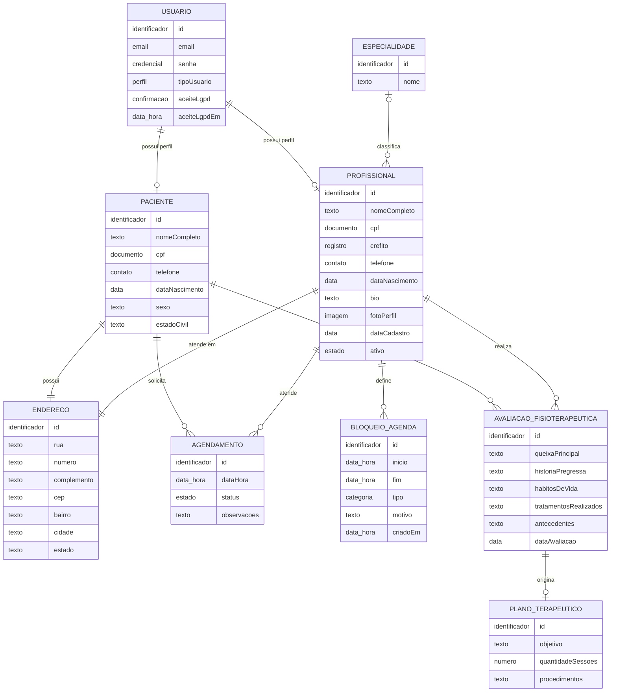

# Diagrama entidade-relacionamento conceitual — AgendaiFisio

Este modelo representa os conceitos de negócio do MVP. Ele não descreve tipos
SQL, índices, triggers ou detalhes internos do Entity Framework.

## Regras conceituais

- Cada usuário do MVP possui um único tipo de perfil: paciente **ou**
  profissional. Os dois perfis são mutuamente exclusivos.
- Cada paciente possui um endereço obrigatório.
- Cada profissional precisa informar um endereço de atendimento para concluir
  o perfil e aparecer com o local completo para os pacientes.
- Um profissional pode estar associado a uma especialidade do catálogo.
- Cada agendamento liga exatamente um paciente a exatamente um profissional.
- Cancelar um agendamento preserva a entidade e altera seu estado para
  `Cancelado`; o registro não é excluído.
- Um profissional pode criar vários bloqueios em sua agenda.
- Uma avaliação é realizada por um profissional para um paciente e pode
  originar, no máximo, um plano terapêutico.
- A imagem do profissional é armazenada externamente; o sistema mantém apenas
  a referência da foto no perfil profissional.

## Legenda de cardinalidade

- `||`: exatamente um.
- `o|`: zero ou um.
- `o{`: zero ou muitos.
